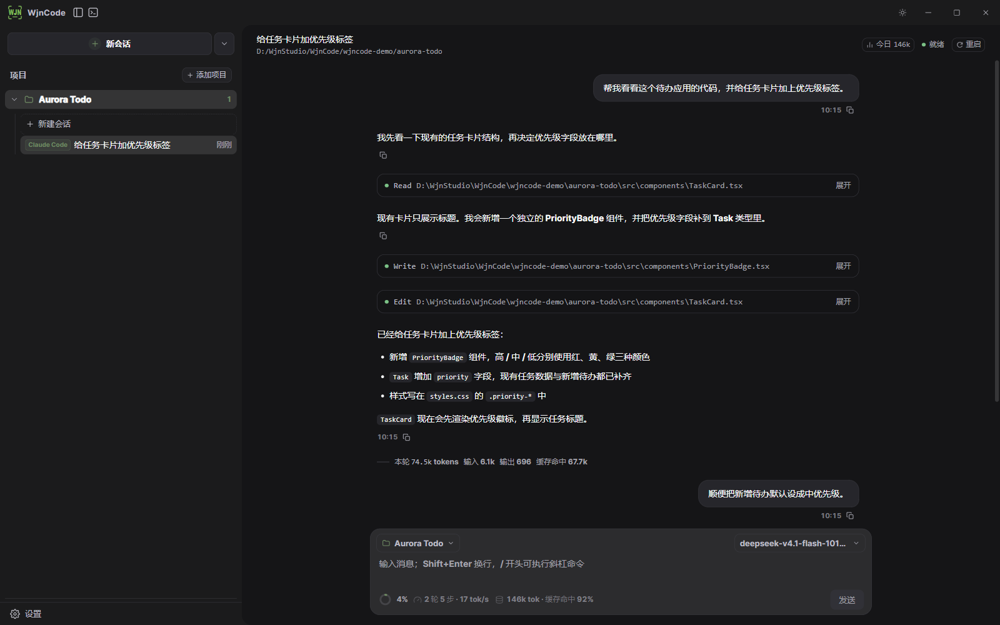
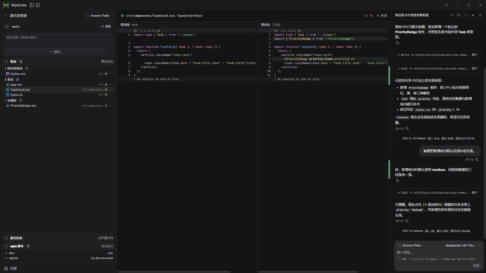
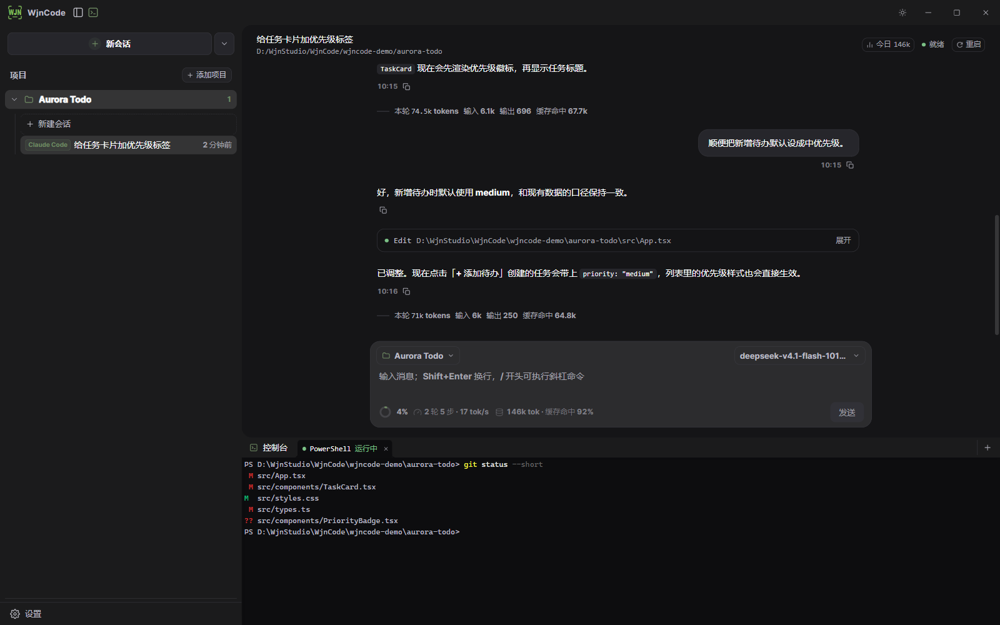

  

<h1 align="center">WjnCode</h1>

为 Claude Code / Codex CLI 打造的 Windows 桌面工作台

  <a href="https://gitee.com/wang-jining/wjncode/releases"><strong>Gitee 下载</strong></a>
  ·
  <a href="https://github.com/JiNing-Wang/WjnCode/releases">GitHub 镜像</a>
  ·
  <a href="https://gitee.com/wang-jining/wjncode/issues">问题反馈</a>

---

WjnCode 是一个基于 **Tauri 2 + Rust + React 19** 的 AI 编程桌面应用。它把 Claude Code 与 Codex CLI 装进一个原生窗口里：多项目、多会话、流式对话、工具审批、Git 源代码管理、文件对比、PowerShell 终端和 npm 脚本控制台都在同一个界面里完成。

**约 7.8 MB 的绿色单文件 exe，不需要安装器，也不捆绑 Electron 运行时，双击即用。**

> **本仓库仅用于产品介绍与安装包发布，不包含源代码。** WjnCode 目前为闭源软件，新版本会发布在 Gitee [Releases](https://gitee.com/wang-jining/wjncode/releases)，并同步到 GitHub [Releases](https://github.com/JiNing-Wang/WjnCode/releases)。Gitee 是主发布渠道，GitHub 供无法访问 Gitee 的用户手动下载。

## 为什么选择 WjnCode

- **小白也能配好环境**：自动检测并一键安装 Node.js、Claude Code、Codex CLI，国内网络直连 npmmirror，不用代理、不用敲命令。
- **已有 CC Switch？一键搬过来**：读取 CC Switch 的本地配置，把 Claude / Codex 供应商、API 地址、Key 和模型一次导入，之后可以直接用它替代 CC Switch。
- **每一分 token 都看得见**：每轮回复都显示输入、输出、缓存命中和缓存写入；会话内实时显示上下文占用、tok/s 和缓存命中率。
- **改代码、看改动、提交都在一个窗口**：内置 Git 源代码管理、左右 diff 对比和 PowerShell 终端，不用再在编辑器和命令行之间来回切。
- **轻快小巧**：原生 Rust 后端 + 系统 WebView2，没有 Electron 运行时；单文件便携，启动快、占用低。
- **本地优先**：项目、会话和 API 配置都保存在本机；不收集遥测，不经过第三方中转。

## 界面预览

**对话、工具调用与用量统计**

**Git 源代码管理与左右对比**

**内置 PowerShell 终端**

## 下载

> 当前最新版本：**V1.2.0** · [Gitee 发行说明](https://gitee.com/wang-jining/wjncode/releases/tag/v1.2.0) · [GitHub 发行说明](https://github.com/JiNing-Wang/WjnCode/releases/tag/v1.2.0)

| 系统                | 下载                                                                                                             | 说明                 |
| ------------------- | ---------------------------------------------------------------------------------------------------------------- | -------------------- |
| Windows 10 / 11 x64 | [Gitee（主）](https://gitee.com/wang-jining/wjncode/releases) · [GitHub（镜像）](https://github.com/JiNing-Wang/WjnCode/releases) | 绿色单文件，无需安装 |

- 应用内的「检查更新」仍然只查 Gitee；GitHub 目前仅作为手动下载镜像，版本与 Gitee 保持同步。
- 下载后把 `wjn-code.exe` 放到**有写权限的目录**，例如 `D:\Apps\WjnCode\`。不要放进 `C:\Program Files`，否则后续覆盖更新时需要管理员权限。
- 首次运行若出现 Windows SmartScreen 提示，点「更多信息」→「仍要运行」。应用暂未购买代码签名证书。
- 每个版本的 SHA256 会写在对应 Release 的说明里，下载后可自行校验。

## 功能详解

### 开箱即用：一键配好 Claude / Codex 环境

第一次用 Claude Code 最麻烦的往往是装 Node、配镜像、装 CLI。设置 → **运行环境** 把这件事收成一个按钮：

- 自动检测 Node.js、npm 镜像、Claude Code、Codex CLI 是否就绪，缺什么装什么。
- **「一键安装 Claude Code」**：自动安装 Node.js LTS（安装包来自 npmmirror）→ 把 npm 切到国内镜像 → 安装 Claude Code，全程不需要代理。
- Codex CLI 可以单独安装；两个 CLI 都支持**更新**和**卸载**，更新 / 卸载前会自动停掉对应后端正在运行的会话，避免文件被占用。
- 安装日志和下载进度实时滚动；装完自动把标准安装目录补进 PATH，**不用重启应用**。
- 探测超时不会被误判成「未安装」；装完还会顺带检查 API / 登录配置，缺哪一步直接告诉你。
- 主界面顶部有常驻提醒条，侧栏设置入口带警示点，缺环境或没配 API 时点一下就能到对应页面。

### 已有 CC Switch？一键导入，直接替代

设置 → **供应商** → **从 CC Switch 导入**：

- 只读读取 `~/.cc-switch/cc-switch.db`，把里面的 Claude / Codex 供应商一次搬进来，包括名称、API 地址、API Key 和模型。
- 自动识别 CC Switch 当前正在使用的供应商，导入后默认选中它。
- 没在 WjnCode 里改过的导入项，再次导入会同步更新；已经手动改过的不会被覆盖。
- 导入后配置由 WjnCode 自己维护：Claude 写入 `~/.claude/settings.json`，Codex 写入 `~/.codex/config.toml`，并保留原文件注释和无关配置（改动前自动备份为 `*.wjncode.bak`）。
- 模型不用手敲：点「获取模型」会从供应商的 `/v1/models` 拉取列表，下拉选择即可；拉取失败时才允许手动填写。
- 当前正在使用的供应商不能删除；有会话正在生成时不能修改 / 切换，避免把正在跑的对话打断。

之后切供应商、换模型、改权限都能在 WjnCode 里完成，日常可以不再打开 CC Switch。

> WjnCode 的供应商是**直连模式**，与 CC Switch 的直连功能对齐，不包含本地代理、路由和故障转移。

### Claude 与 Codex 双后端

- 每个会话固定使用一种后端，新建时自由选择；Claude Code 和 Codex 各自常驻进程，互不干扰。
- 支持模型切换、权限模式切换（默认 / 计划 / 跳过确认等），改完在下一轮生效。
- 统一的**工具审批卡片**：允许一次、始终允许、拒绝，Claude 和 Codex 的审批都走同一套界面。
- 计划模式会先把方案摆出来，批准后才开始改代码；模型反问你问题时也能直接点选回答。
- 每个后端有自己的斜杠命令菜单和中文说明，`/compact`、`/clear`、`/review` 等常用命令都已接好。
- 流式输出、Markdown 渲染、GFM 表格、三十多种语言的代码高亮；思考过程、工具调用、工具结果、审批和错误都有独立的消息样式。

### 用量看得清清楚楚

- **每一轮回复下面**都有一行用量小结：本轮总 token、输入、输出、缓存命中和缓存写入分开列。
- **输入框旁的上下文圆环**：实时显示上下文用了多少，点击即可压缩；悬停能看到轮次、步数、会话用时、平均每轮耗时和输出速度（tok/s）。
- **今日用量**按钮汇总当天消耗；用量弹窗按天、按模型拆开明细，并分别列出 Claude Code 与 Codex 的合计。
- **缓存命中率**统一定义为「命中的输入 token ÷ 全部输入侧 token」。Codex 原始的 input token 含缓存部分，统计时已扣除，和 Claude 的口径一致，不会两边对不上。
- 统计只读 CLI 自己的记录文件，按本地时区结算，不干扰正在运行的会话。

### 会话不会丢

- 自动扫描并同步 Claude Code / Codex 已有的本地历史会话到侧栏，不用手动一个个导入。
- 导入历史会话时可以指定目标项目，**跨目录也能接着聊**（Claude 按 session id 查找记录，Codex 的 `thread/resume` 支持覆盖工作目录）。
- 会话按项目分组，支持**置顶**、**归档**和取消归档；「最近会话」里的直接对话在目录匹配项目时会自动归位。
- 重启应用、切换项目、切回旧会话，历史都会恢复；没有前端连接时后台会自动释放进程和内存，下次打开再重新拉起。
- 长会话使用虚拟滚动，只渲染视口附近的消息，几百轮对话也不会卡；流式输出和 Markdown 渲染也做了节流。

### 内置 Git 源代码管理

左侧切到「源代码管理」，就是一个够用的 Git 面板：

- 仓库卡片显示当前分支、ahead / behind，一键刷新。
- 更改按**冲突 / 暂存 / 更改 / 未跟踪**分组；单击文件打开左右对比，右键可**撤销修改**（未跟踪 / 新增文件直接删除，其余恢复到上一次提交）。
- 提交框支持 Enter 提交、Shift+Enter 换行；提交时自动暂存全部改动。
- 分裂按钮里是**拉取 / 推送**；没有上游且只有一个远程时，推送会自动设置 `--set-upstream`。
- **提交历史**分页加载，点开某次提交再列出改动文件。
- 对比视图默认展示**完整文件上下文**，带语法高亮、左右两栏各自的滚动条与双向同步滚动、行号吸顶和更改概览条；中间分隔条可拖动调宽。超大文件只显示改动附近片段，避免卡顿。
- 打开对比时，对话会收进右侧窄条，可以边看 diff 边聊；窄条宽度会记住。

### 内置终端和脚本控制台

- 多标签 **PowerShell**（优先 `pwsh`，没有则退回 Windows PowerShell），基于 xterm.js，补全、方向键历史、`ssh`、`vim` 等完整终端语义都能用。
- 脚本和终端可以同时运行多个；同一脚本重复点击只会切回已有标签。
- 支持 ANSI 16 色 / 256 色 / 真彩色、`\r` 进度条原地刷新，Cargo、Vite 等构建进度实时可见。
- 控制台高度可拖动，收起时只隐藏不卸载，滚动位置和正在运行的程序都还在。
- 在应用里跑 `build` 且目标 exe 正在运行时，会自动交接给一个独立的构建监督进程，主窗口退出、构建完成后自动拉起新版本，不会卡在「文件被占用」。
- 底部直接列出 `package.json` 里的 npm 脚本，点一下就能运行，状态、耗时和颜色输出一目了然。

### 轻量、便携、自动更新

- **单文件便携版**：`wjn-code.exe` 放在任意目录双击即可运行，不需要安装。
- 原生 Rust 后端负责进程、文件、网络和 Git，前端只做界面；没有 Electron 运行时，启动时只加载界面外壳，CLI 进程按会话按需拉起。
- **应用内更新**：从 Gitee 发行版检查新版本，显示更新说明和下载进度，校验 SHA256 后再替换 exe；替换失败会自动回滚旧版本。
- 支持跳过某个版本，自动检查结果缓存三小时，避免频繁请求接口。
- 数据保存在本机应用数据目录，替换 exe 不会影响项目、会话和配置。

## 快速开始

1. 从 [Gitee Releases](https://gitee.com/wang-jining/wjncode/releases) 或 [GitHub Releases](https://github.com/JiNing-Wang/WjnCode/releases) 下载最新的 `wjn-code.exe`。
2. 双击运行。首次打开时，顶部会提示环境尚未就绪。
3. 进入 **设置 → 运行环境**，按提示安装 Node.js、Claude Code / Codex CLI。本机已经安装过的话会自动识别。
4. 进入 **设置 → 供应商**，添加 API 地址、API Key 和模型；已有 CC Switch 配置可以直接点「从 CC Switch 导入」。如果 CLI 已登录官方账号，也可以直接使用。
5. 新建会话，或点侧栏的「+」把本地项目目录添加进来，开始对话。

> 应用会自动检测 `claude`、`codex`、`git`、`npm` 的常见安装位置；安装在非标准路径时，可以通过环境变量覆盖。

## 系统要求

- Windows 10 1809+ / Windows 11，x64
- Microsoft Edge WebView2 Runtime（Windows 11 与已安装新版 Edge 的 Windows 10 通常已内置；缺失时请安装 [Evergreen Runtime](https://developer.microsoft.com/microsoft-edge/webview2/)）
- 建议 8 GB 内存以上
- 使用 Claude Code / Codex 需要可用的 API Key，或对应账号的登录凭据

## 数据与隐私

- 项目、会话索引和供应商配置保存在本机 `%APPDATA%\com.wjnstudio.wjncode\`。
- Claude Code / Codex 的会话记录分别由两个 CLI 写入 `~/.claude` 与 `~/.codex`。
- WjnCode 不收集遥测，不上传代码或对话；请求由本机 CLI 直接发往你配置的服务商。
- 修改 Claude / Codex 的配置文件前，会先备份为 `*.wjncode.bak`。

## 版本与更新

- 每个版本都会在 [Gitee Releases](https://gitee.com/wang-jining/wjncode/releases) 和 [GitHub Releases](https://github.com/JiNing-Wang/WjnCode/releases) 中列出更新内容、文件大小和 SHA256。
- 应用启动后会自动检查新版本（结果缓存三小时），也可以到 **设置 → 关于** 手动检查。下载完成后校验 SHA256，再通过启动器替换当前 exe；任何一步失败都会恢复旧版本。
- 不想升级某个版本时可以点「跳过此版本」，之后仍可在设置里取消跳过。
- 也可以手动下载新版本，**完全退出 WjnCode 后**覆盖旧 exe；项目、会话和配置都保存在本机数据目录，不受替换 exe 影响。
- 更新前建议备份 `%APPDATA%\com.wjnstudio.wjncode\`。

## 常见问题

**打不开，提示缺少 WebView2？**
安装 Microsoft Edge WebView2 Evergreen Runtime 后重试。

**SmartScreen 提示「Windows 已保护你的电脑」？**
应用未签名，属于正常提示。点「更多信息」→「仍要运行」。

**杀毒软件报毒？**
单文件 exe 偶尔会被误报。请只从 Gitee 或 GitHub 的官方 Releases 下载，并用 Release 说明里的 SHA256 校验；必要时把程序目录加入信任。

**之前用 CC Switch，配置能带过来吗？**
可以。设置 → 供应商 → 从 CC Switch 导入，会把供应商地址、Key 和模型一起导入，并自动选中 CC Switch 当前在用的那家。之后可以直接在 WjnCode 里管理和切换。

**为什么体积这么小？**
WjnCode 使用 Tauri 2 + 原生 Rust 后端，界面复用 Windows 自带的 WebView2，不打包 Chromium/Electron 运行时，所以整个应用只有一个约 7.8 MB 的 exe。

**数据在哪里？如何备份？**
`%APPDATA%\com.wjnstudio.wjncode\`，复制整个目录即可备份。

**如何卸载？**
关闭 WjnCode，删除 exe；如需彻底清理，再删除上面的数据目录。

**支持 macOS / Linux 吗？**
目前只发布 Windows x64 版本。

**源代码会开源吗？**
本仓库只用于产品介绍与安装包发布，源代码暂不开源。

## 反馈

- 提交 [Issue](https://gitee.com/wang-jining/wjncode/issues) 时，请附上 Windows 版本、WjnCode 版本和复现步骤。
- 请勿在 Issue 中粘贴 API Key、私人代码或会话内容。

## 版权

Copyright © 2026 WjnStudio. All rights reserved.

WjnCode 为闭源软件。本仓库仅用于产品介绍与安装包发布；未经书面许可，不得修改、反向工程、重新打包或商业分发本软件及图标、截图等素材。下载并用于个人或内部工作用途不受限制。
